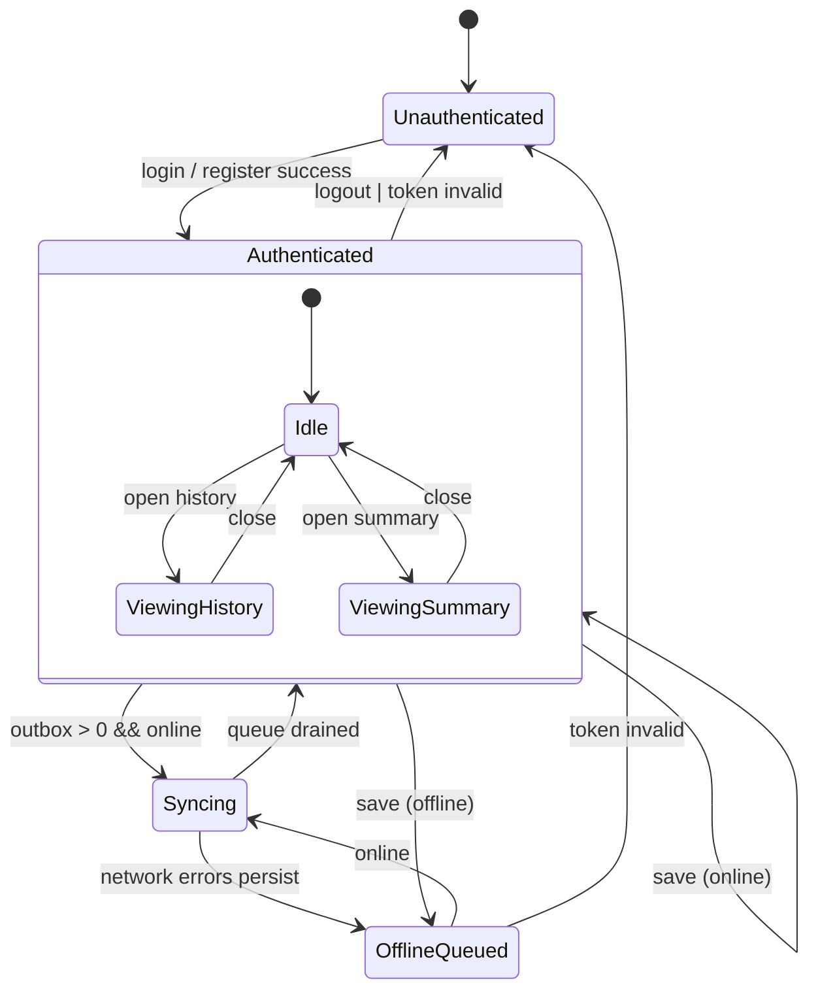
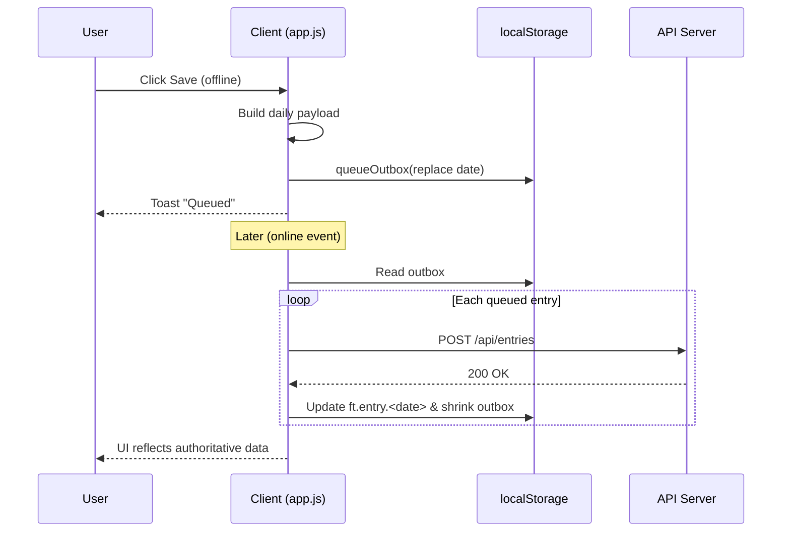

# Behavior Specification
Version: 2025-08-24
Scope: Current Fitness Tracker PWA (web/ + server/) – target state with minimal, maintainable logic and durable cumulative persistence.
Audience: Engineering, Product, QA

---
## 1. Goals & Non‑Goals
**Goals**
- Provide deterministic, minimal user flows for registration, authentication, daily tracking, history review, weekly summary, offline capture, and sync.
- Ensure cumulative persistence of workout data: local (for responsiveness / offline) and server (authoritative) with user-driven modification only.
- Keep logic surface small: no redundant pathways, no duplicated state mutation.
- Preserve a minimalist UI: single auth card, single app screen (no nested navigation), restrained color palette, fixed exercise list layout, modal overlays for History & Summary only.
- Guarantee structural stability of Workout History (column order: Date, Weight, Completed Count, Exercises (editable detail), Actions) and Weekly Summary (Week Of, Weight Avg., fixed per‑exercise columns, Total) regardless of future additions.
- Enforce NO duplicate daily rows in Workout History (de‑dup before render).

**Non‑Goals**
- Advanced analytics, exercise customization, multi-user switching, and data export (future enhancements).
- Introducing additional UI chrome (sidebars, tab bars) that would increase cognitive load.

---
## 2. Core Entities
| Entity | Description | Identity | Persistence |
|--------|-------------|----------|------------|
| User | Authenticated account | email (unique) / user_id (DB) | DB only (token in client) |
| Daily Entry | One calendar day of sets + optional weight | (user_id, date) | DB authoritative + local cached snapshot |
| Weekly Summary | Aggregation (Sunday-based) of entries | (user_id, week_of_sunday) | Derived (recompute) + optional cache |
| Offline Outbox Item | Pending POST for a date | (path, date) | localStorage queue |

---
## 3. Client State Model
Primary in-memory state is ephemeral; persistent keys below.

### 3.1 Persistent Storage Keys (Proposed Canonical Set)
| Key | Type | Scope | Purpose |
|-----|------|-------|---------|
| `ft.jwt` | string | localStorage | Auth token |
| `ft.outbox` | JSON array | localStorage | Pending POST entries |
| `ft.entry.<YYYY-MM-DD>` | JSON | localStorage | Cached canonical last-known server state for that date |
| `ft.summary.cache` | JSON { generatedAt, weeks:[] } | localStorage | Optional summary cache for offline viewing |
| `ft.meta.version` | string | localStorage | Schema/version marker |

### 3.2 In-Memory Runtime State (Minimal)
| Variable | Contents |
|----------|----------|
| `currentUserEmail` | Display email (from auth response or /api/me) |
| `stationsCounts` | Transient representation of UI (derived from DOM on demand) |
| `isOffline` | Mirror of `!navigator.onLine` / events |

No redundant duplication of data; DOM is single source for unsaved current-day modifications until Save triggers persistence.

---
## 4. Application State Machine

### 4.1 State Diagram (Mermaid)



Legend:
- Idle: Authenticated main view (today's workout)
- ViewingHistory / ViewingSummary: Modal substates (UI overlay only)
- OfflineQueued: Conceptual (badge) when outbox has entries
- Syncing: Active flush of outbox

### 4.2 Alternate ASCII (reference)

```
+------------------+
|  Unauthenticated |<-------------------+
+---------+--------+                    |
          | Login/Register Success      | (Logout / Token invalid)
          v                              |
+------------------+         Network loss (while saving)       
| Authenticated    |---------------------------+               
|  (Idle/View Day) |                           |               
+----+------+------+/ Save (online)            |               
     |      |       (mutate server & cache)    |               
     |      |                                   |               
     |      +--> Open History --------------+   |               
     |             (ViewingHistory)         |   |               
     |                                      |   |               
     |      +--> Open Summary --------------+   |               
     |             (ViewingSummary)         |   |               
     |                                      |   |               
     | Offline Save (POST)                  |   |               
     v                                      |   |               
+------------------+                        |   |               
|  OfflineQueued   |<-----------------------+   |               
| (Pending Sync)   |  (Any queued items)        |               
+---------+--------+                            |               
          | Online + Token valid                |               
          v                                     |               
+------------------+  Sync success / partial -> |               
|  Syncing         |----------------------------+               
+---------+--------+                                            
          | (All succeeded)                                     
          v                                                     
+------------------+                                            
| Authenticated    |                                            
|  (Idle/View Day) |                                            
+------------------+                                            
```

### 4.3 Offline Save → Sync Sequence (Mermaid)



**State Transition Rules**
- Only Unauthenticated ↔ Authenticated transitions manipulate the token.
- OfflineQueued is conceptual overlay when outbox length > 0 (not exclusive state; UI badge condition).
- Syncing enters upon `online` or boot if outbox non-empty; exits when queue drained or stagnates (failures remain).
- ViewingHistory / ViewingSummary are modal substates; underlying base state remains Authenticated Idle (no persistent state change beyond user edits).

---
## 5. Behavioral Flows (Condensed with Persistence Points)

### 5.1 Registration
1. Validate non-empty email/password (client minimal; server full rules).
2. POST `/api/auth/register` → token.
3. Persist `ft.jwt`.
4. Fetch or accept returned user email -> `currentUserEmail`.
5. Call Boot flow.

### 5.2 Login (Same except endpoint)

### 5.3 Boot Flow
1. If token missing -> remain Unauthenticated.
2. If token present -> GET `/api/me`; on 401 clear token → Unauthenticated.
3. Build stations UI.
4. Load cached today entry (`ft.entry.<date>`); apply sets (optimistic preload).
5. GET `/api/entries/:date` for authoritative; reconcile & update cache key.
6. If outbox not empty -> enter Syncing (flush queue sequentially, updating per-date cache on success).

### 5.4 Daily Edit & Save
1. User modifies counts (DOM state only until save).
2. Save -> Construct payload from DOM.
3. If offline: enqueue (replace existing same-date entry) in `ft.outbox`; DO NOT update `ft.entry.<date>` until successfully synced (avoids divergence). Provide optimistic UI toast.
4. If online success: update `ft.entry.<date>` with server response.

### 5.5 Outbox Flush (Syncing)
For each deduped item ordered by timestamp:
- Attempt POST.
- On success: update matching `ft.entry.<date>` cache.
- On failure: keep in remainder list.
Stop after one full pass. If remainder non-empty and still offline or server error, remain with badge (OfflineQueued). Retry on next `online` event or manual Save.

### 5.6 History View
1. If cache for range not maintained, GET `/api/entries`.
2. Populate table. For each row: write/update `ft.entry.<date>` cache with row content.
3. De‑duplication: client reduces dataset to a single row per `entry_date` (latest wins) BEFORE rendering to eliminate any residual duplicates from legacy or race conditions.
4. Edit Save inside history uses POST -> update cache on success.
5. Delete -> DELETE; remove `ft.entry.<date>` cache key (soft remove) and update table.
6. Structure Integrity: Columns remain fixed; dynamic exercise detail inputs render inside the Exercises cell only (no column proliferation) to preserve table stability on small screens.

### 5.7 Summary View
1. Optional: if `ft.summary.cache.generatedAt` fresh (< N minutes) use cache; else GET `/api/summary`.
2. On success: store new summary cache.
3. Display table with immutable column order (Week Of | Weight Avg. | Per‑exercise columns (fixed set) | Total). Any new exercise introduced in the future MUST appear after existing canonical columns to preserve layout predictability.

### 5.8 Logout
1. Clear `ft.jwt`.
2. (Optional) Retain local entry caches for offline reference (choose: keep or purge; recommended keep for continuity).
3. Reload to Unauthenticated.

---
## 6. Data Integrity Rules
| Rule | Rationale |
|------|-----------|
| Single source for unsaved modifications is DOM / transient memory | Prevents double buffering complexity |
| Cached entry never updated optimistically for offline save | Avoids false correctness before server acceptance |
| Outbox only stores full daily overwrite (idempotent) | Simplifies merging and conflict resolution |
| Date keys use UTC (`new Date().toISOString().slice(0,10)`) | Eliminates timezone drift / DST issues |
| Deletion removes local cache key | Keeps cache congruent with server |
| Summary cache TTL (e.g., 10m) | Performance without stale risk |
| Render History with strict de‑dup (latest per day) | Prevents duplicate visual noise / accidental multi-save confusion |
| Fixed column order for History & Summary | Ensures consistent muscle memory & automated test selectors |
| Minimal UI surface (one primary screen + two modals) | Reduces complexity and failure points |

---
## 7. Minimal API Contract (Client <-> Server)
| Endpoint | Method | Body | Success (200) | Errors |
|----------|--------|------|---------------|--------|
| /api/auth/register | POST | { email, password } | { token, user:{email} } | 400 duplicate, 400 invalid |
| /api/auth/login | POST | { email, password } | { token, user:{email} } | 401 invalid |
| /api/me | GET | — | { email, id } | 401 unauthorized |
| /api/entries | GET | — | [ EntryRow ] | 401 |
| /api/entries/:date | GET | — | EntryRow|null | 401 |
| /api/entries | POST | { date, weight, fitnessData } | EntryRow | 400 validation, 401 |
| /api/entries/:date | DELETE | — | { ok:true } | 401, 404 (optional) |
| /api/summary | GET | — | [ SummaryRow ] | 401 |

EntryRow: { entry_date, weight, fitness_data }
SummaryRow: { week_of_sunday, weight_avg, totals }

---
## 8. Offline & Conflict Semantics
- Model: Last-write-wins per date (POST overwrites entire daily record).
- Conflict Example: Device A offline modifies date D; device B online updates D; A reconnects later: A’s queued POST overwrites B (temporal, not semantic ordering). Future enhancement: include `updated_at` and reject if server newer than client timestamp.

---
## 9. Simplicity / Minimalism Guidelines
| Area | Guideline |
|------|-----------|
| DOM IDs | Slugify exercise names once; reuse constants |
| Event Binding | Delegate where possible; bind once per container |
| State | No duplicate mirrors (avoid storing counts object + DOM) |
| Error Surfacing | Use consistent toast/alert wrapper, avoid scattered alerts |
| Fetch Wrapper | Keep diagnostics optional (flag) to prevent overhead in production |
| SW Strategy | network-first HTML; stale-while-revalidate JS/CSS; cache-first immutable icons |
| Extensibility | Prefer additive data keys with version marker rather than schema migration scripts |
| Layout | Single-column responsive container; avoid adding new wrapper divs unless semantically necessary |
| Modals | Reuse the same modal base styles; no additional overlapping modal layers |
| CSS | Consolidate shared tokens in `tokens.css`; no inline style blocks beyond critical fallback |
| Table Stability | Never alter existing column sequence; append only at tail with a versioned migration note |

---
## 10. Security & Access Management Essentials
- Authentication: JWT (bearer) per request; consider short-lived with refresh token (future).
- Storage: JWT only; never store password or PII beyond email.
- CSP: `script-src 'self'`; no inline scripts; strict `connect-src`.
- Rate Limiting (future): throttle auth endpoints.
- Input Validation: server-side enforce email/password length and complexity.
- XSS Mitigation: Avoid innerHTML with untrusted user content (current exercise names are static). If user-provided exercises added, sanitize before insertion.

---
## 11. Accessibility Requirements (Simplified)
| Element | Requirement |
|---------|------------|
| Modals | `role="dialog"`, `aria-modal="true"`, focus trap, Esc close |
| Progress Bar | `role="progressbar"`, `aria-valuenow`, `aria-valuemin=0`, `aria-valuemax=100` |
| Buttons | Discernible text / aria-labels |

---
## 12. Observability & Diagnostics
| Layer | Minimal Metric/Log |
|-------|--------------------|
| Auth | login success/failure count (console or future endpoint) |
| Offline | queue length changes |
| Sync | per-entry sync result (success/fail) |
| Errors | unhandledrejection / window.error aggregated to banner |

Future: Optional structured log buffer for export when debugging.

---
## 13. Open Backlog (Prioritized)
1. Slugified exercise IDs & removal of space-containing DOM ids.
2. UTC date standardization.
3. Add local entry cache & summary cache (if not yet implemented) – improves offline history viewing.
4. Stale-while-revalidate for scripts/styles.
5. Conflict detection with `updated_at` comparison.
6. Accessibility enhancements (dialogs, progress bar ARIA).
7. Structured diagnostics toggle (dev flag) instead of permanent fetch monkey-patch.

---
## 14. Acceptance Criteria (Critical Flows)
| Flow | Criteria |
|------|----------|
| Save Online | POST returns 200; local cache updated; UI toast; progress unaffected except sets changed |
| Save Offline | Outbox length increments/replaces; no cache update; toast indicates queue |
| Sync After Reconnect | Each queued item attempts POST; success removes item & updates cache; failures remain |
| History Edit | POST updates server + cache; table refresh reflects change |
| History Delete | Entry removed server + cache; table reflects absence |
| Summary | Data matches aggregation from entries (spot-check with manual sum) |
| Logout | Token removed; reload shows auth; cached entries persist (if design chosen) |
| History No Duplicates | Rendering layer shows at most one row per date after de‑dup pass |
| Minimalist UI | Only auth card visible pre-login; only one primary container + two modal overlays post-login |
| Column Order Invariance | Automated test comparing expected column headers passes (no reorder) |
| Cumulative Persistence | After reload (online), previously saved days reappear identically (unless explicitly modified) |

---
## 15. ASCII Sequence (Example: Offline Save then Sync)
```
User       App.js            Storage          Network/API          Server
 |  Click Save   -> build payload  ->                |                |
 |               -> navigator.offline? yes          |                |
 |               -> enqueue outbox (replace date)  -> localStorage   |
 |  Toast queued                                    |                |
 | (Later online event)                            ->               (online)
 |               -> flushOutbox iterate entry       -> fetch POST -> validate/store -> 200
 |               <- success JSON                    <- response      |
 |               -> update ft.entry.<date>          -> localStorage  |
 |               -> remove from queue               -> localStorage  |
 |  Toast saved (optional)                          |                |
```

---
## 16. Future Extension Hooks
- Plug-in architecture for new exercise categories (provide metadata array + slug generator).
- Background Sync API registration for automatic outbox flush (progressive enhancement).
- Encryption layer for local cached entries (key derived from password). Optional, out of current scope.

---
## 17. Summary
This specification defines a lean, deterministic workflow prioritizing cumulative, durable, and conflict-aware data handling while minimizing duplicated state. Adhering to the outlined state machine, storage schema, and acceptance criteria ensures predictable behavior across online/offline transitions and supports future incremental enhancements without architectural churn.

End of document.
